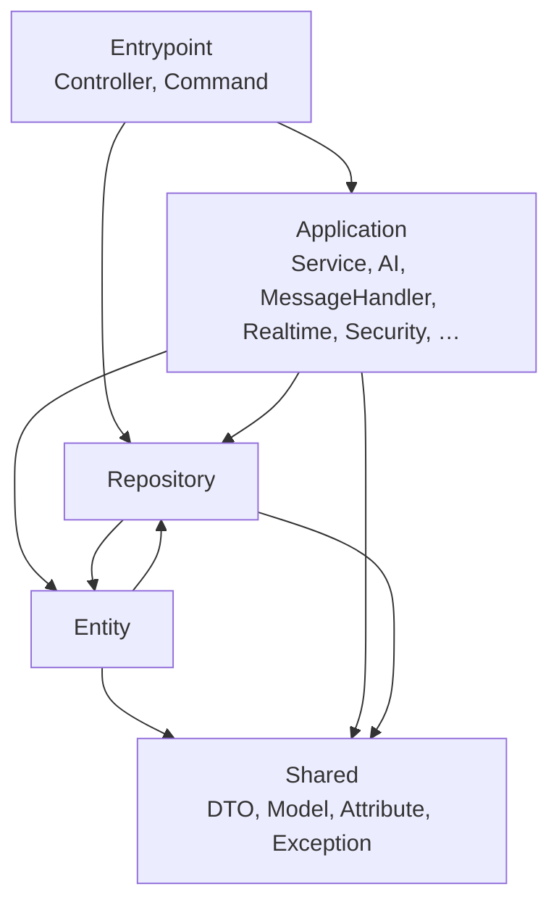
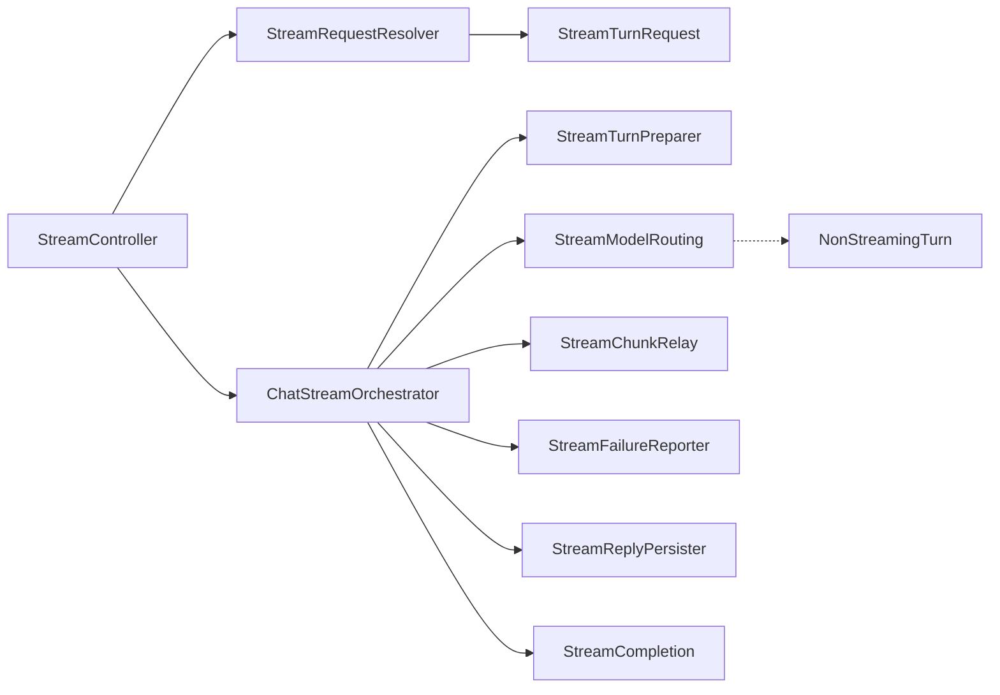

# Backend architecture

How the Symfony backend in `backend/` is put together, and where new code
goes. Two checks keep the shape: deptrac enforces the layers, and the size
ratchet keeps classes and methods small. Both run in `make ci-local` and CI.

The request paths below were "god classes" until the code cleanup V2 and V3
sprints (`_devextras/planning/2026-archive/20261014-code-cleanup-V2/`,
`_devextras/planning/2026-archive/20261015-code-cleanup-V3/`). The runtime
config and the chat turn sections describe the code of
[#2498](https://github.com/metadist/synaplan/pull/2498) and
[#2499](https://github.com/metadist/synaplan/pull/2499); the message turn,
file analysis and tagged-list sections the V3 pull requests
[#2512](https://github.com/metadist/synaplan/pull/2512)–[#2514](https://github.com/metadist/synaplan/pull/2514).

## Layers

| Layer | Namespaces (`App\…`) | May use |
| ----- | -------------------- | ------- |
| Entrypoint | `Controller`, `Command` | Application, Repository, Entity, Shared |
| Application | `Service`, `AI`, `Mcp`, `Realtime`, `Plug`, `Prompt`, `Module`, `Runtime`, `Message`, `MessageHandler`, `EventSubscriber`, `EventListener`, `Security`, `Seed`, `Observability`, … | Application, Repository, Entity, Shared |
| Repository | `Repository` | Repository, Entity, Shared |
| Entity | `Entity` | Entity, Repository, Shared |
| Shared | `DTO`, `Model`, `Attribute`, `Exception` | Shared |

`backend/deptrac.yaml` is the source of truth. `make -C backend deptrac` fails
on a new violation. The baseline (`deptrac.baseline.yaml`) only lists what
predates the gate and may only shrink: fix the import (move a value object to
`App\Model\`, pass a value instead of a service), never add an entry.

## Size limits

A file has at most 800 lines, a constructor at most 10 parameters, a method
body at most 100 lines. `make -C backend metrics` prints how many files,
constructors and methods exceed that, with the largest of each kind.

`tests/Architecture/SizeRatchetTest.php` freezes every offender that existed
when the limits came in (`sizeRatchetBaseline.json`). A frozen entry may
shrink or disappear, never grow, and a new offender fails the test. When the
test goes red, put the new code into a class of its own instead of the one
that is already too big. After shrinking a class, regenerate the ledger with
`UPDATE_SIZE_RATCHET=1` — its diff contains removals only.

Value objects count too: a constructor with eleven fields is split into
smaller objects that each mean something (see the stream request below).

## Runtime config — `GET /api/v1/config/runtime`

`ConfigController` only delegates. `RuntimeConfigAssembler` merges the
payload from services tagged `app.runtime_config.contributor`: auth, billing,
chat, features, branding, speech and modules each own their part. `features`
is merged one level deep; every other top-level key belongs to exactly one
contributor, and a second writer throws. A new runtime key is a new
contributor, not a new branch in the controller.

The model routes of the same controller delegate to `ModelListingService`,
`ModelDefaultsService`, `RoutingModelsService` and `ModelAvailabilityCheck`.
Large OpenAPI response schemas live in `App\Attribute\OpenApi\Config\*`, so
the routes stay in one controller: the spec orders `paths` by route
registration, and the frontend pins a hash of the spec.

## Chat turn — `ChatHandler`

`App\Service\Message\Handler\ChatHandler` answers a message with the model the
person chose. It is a short orchestrator; every turn runs through the same
stages in `App\Service\Message\Chat\`:

| Stage | Produces |
| ----- | -------- |
| `ChatTurnContextLoader` | `ChatTurn`: runtime profile, topic prompt, knowledge base, memories |
| `ChatModelSelector` | `ChatModelChoice`: "Again" > widget > assistant > prompt > default; retired models swapped; image model fallback |
| `ChatSystemPromptAssembler` | `ChatSystemPrompt`: sections in channel order, or a user-turn fallback for models without a system role |
| `ChatMessageAssembler` | the provider messages |
| `ChatRequestOptions` | document schema, routing tools, token ceiling, sampling, reasoning level |
| `ChatReplyGenerator` | `ChatReply`: document tool loop or chat call, with the cut-off and empty-answer checks |
| `PendingMemoryExtraction` | the memory job, dispatched now or after the reply is stored |

`handle()` serves the buffered channels (email, webhook, MCP, Telegram) and
`handleStream()` the web chat and the widget. Each stage has a
`forBufferedTurn()` and a `forStreamedTurn()` that share their private
sections. The remaining differences between the two (when a deferred routing
decision is checked, the voice rules, how a generated file is delivered) are
named in the stage that owns them. Aligning them is behaviour work and shows
in the prompt snapshots of `tests/Characterization/`.

## Chat stream — `POST|GET /api/v1/messages/stream`

`StreamController` keeps its four routes and their OpenAPI attributes and
delegates:

- **Request.** `StreamRequestResolver` turns the request into a typed
  `StreamTurnRequest`: the caller (signed-in person, widget visitor, guest —
  `StreamCallerResolver`), the pinned assistant (`StreamAgentPinResolver`),
  the input, the options and the incognito history. A request that cannot
  start a turn becomes a `StreamRequestRejected` with its JSON error, or the
  guest-limit event.
- **Turn.** `ChatStreamOrchestrator` runs inside the streamed response:
  report a rate limit, open the resumable run, prepare the chat and the
  incoming message, route a model that cannot stream to `NonStreamingTurn`,
  relay the chunks, then report a failure or store the reply and send
  `complete`. Every path closes the run; nothing is left "running".
- **Wire.** `SseWriter` writes one `data:` frame per event and records it in
  the run, so a client that reloads can re-attach. The event names are an
  external contract: the web chat, the widget, the desktop and the mobile
  apps read them. A new event is a `feat:` with frontend work.
- **Stop.** `CancelledTurns` flags a turn the caller owns and stores the
  partial answer the client sends.

`tests/Characterization/StreamTranscriptCharacterizationTest.php` locks the
ordered event names and payload shapes of six turns; a split that changes a
frame fails it.

## Message turn — `MessageProcessor`

Below the stream (and below email, MCP, Saved Tasks and webhooks),
`App\Service\Message\MessageProcessor` runs one turn. `process()` is the
buffered turn, `processStream()` the streamed one; both run the same stages
in `App\Service\Message\Processing\`:

| Stage | Does |
| ----- | ---- |
| `TurnClassificationResolver` | fixed prompt, Again, forced image description or the AI sorter; the `classifying` / `classified` statuses; the prompt behind the topic |
| `TurnHistoryLoader` | incognito, chat or legacy history; the rolling summary of older turns |
| `TurnWebSearch` + `LinkedContentReader` | pasted links first (Confluence and Jira through the user's connection), then the search decision, the search and the page reads |
| `TurnDispatcher` | the `generating` status, then the task plan executor or the inference router; the handler's effective classification |
| `TurnStatus` | one turn's statuses, to the caller's callback and the log |

Both turns decide alike. A turn is classified once, with its history; the
caller's widget flag and knowledge-base scope go on the classification. When
the sorter does not run, the caller's language wins, then the message's own,
then English (`auto` for a fixed prompt). The prompt is looked up once in the
turn's language: its metadata on the classification, the bundle in
`resolved_prompt_data`. Web results travel in `options['search_results']`.

Of the differences code cleanup V3 named, three stay, each because only one
transport has what it needs:

| Difference | `process()` (buffered) | `processStream()` (streamed) | Why |
| ---------- | ---------------------- | ---------------------------- | --- |
| `complete` / `error` status | reported by the turn | reported by the caller | the stream's caller owns its terminal events; a buffered caller has no stream |
| A user's Stop | a generic failure | `cancelled: true` | only a stream has a Stop button |
| Phase timings | none | a `PerfTimer` per phase | only the stream has a consumer for them |

A buffered turn's `classified` status also carries the verdict.
`MessageTurnCharacterizationTest` pins both turns and the sorter calls each
makes; `TurnAlignmentTest` pins every aligned rule. The moved code keeps weak
typing (no `strict_types`) until its boundaries are typed.

A model the user picked routes by one rule. A model override in
`MessageClassifier` and an Again in `TurnClassificationResolver` both ask
`Capability\TopicIntentRule`: the model's tag names the kind of answer when
it can (media tags `mediamaker`, vision and analysis tags `general`, document
tags `officemaker`); any other tag, a chat model among them, keeps the
message's topic, so a custom prompt survives, and a message without one goes
to `general` (the placeholders `UNKNOWN`, `CHAT` and `CONTINUE` are no topic).
The intent comes from `SystemCapabilityRegistry`, then the routing aliases,
else chat. A media route takes a media model: a chat model kept on a media
topic leaves the choice to the media handler's default.
`OverrideAndAgainRoutingTest` pins both paths on one table.

## Channel turns

A channel's entry point reads as its stages, in order. Each stage is a
service and hands the next one a typed value, never the request or a loose
array.

**Widget** — `WidgetPublicController::message()`, `App\Service\Widget\Turn\`:

| Stage | Does |
| ----- | ---- |
| `WidgetTurnGate` | admits the visitor's message as a `WidgetTurn` or refuses it (`WidgetRequestRefused`): the body, the widget and its owner's limits, the domain (`WidgetDomainGuard`), the session (`WidgetSessionResolver`, the owner's test and internal mode), the session's message limit, the owner; records the visitor's country |
| `WidgetConversation` | stores the message (`StoredVisitorMessage`): the session's chat or a new one with the welcome, the live dashboard event, the trigger-phrase page (`WidgetHandoff`), the session's own files, one flush for counter, preview and chat link; `awaitOperator()` when a person runs the session |
| `WidgetReply` | streams the AI answer through `SseWriter`, detached from the connection and recorded as a resumable run; `WidgetAnswerChunks` turns chunks into frames, `WidgetAnswerStore` keeps the finished answer |

`WidgetTurnCharacterizationTest` pins every way the turn's output leaves —
frames, stored rows, realtime events, Slack, Discord, usage, generated
media, the run and the flush count — over nineteen cases.

**Inbound email** — `WebhookController::email()`, `App\Service\Email\Turn\`:

| Stage | Does |
| ----- | ---- |
| `InboundEmailIntake` | accepts the relay's email as an `InboundEmail` (with its `EmailThread`) or answers it without a turn (`InboundEmailAnswered`): the payload, a raw MIME body read as its text, the keyword, the idempotency check (a redelivery is a duplicate, never answered twice), the sender's account and its limit; a refused sender and a spent limit are told by mail |
| `EmailConversation` | stores the email in the sender's email chat (`StoredInboundEmail`) with its metadata and attachments; an audio attachment asks for a spoken reply |
| `EmailReply` | answers by mail: the usage and the stored answer (`EmailAnswerStore`), the spoken reply (`EmailVoiceReply`), the reply in the same thread with its files (`EmailReplyAttachments`) and doc links; a failed answer still mails the sender |

`EmailTurnCharacterizationTest` pins the answer to the relay, the mail each
delivery sends, the stored rows, the account, speech, usage, the summary
refresh, the attachment store and Discord over fourteen cases.

## File analysis — `FileAnalysisHandler`

`FileAnalysisHandler` answers about the files of a turn on one path for both
pipelines; `AnalysisReply` is the only difference (content returned, or
streamed through the callback). `AnalysisFileResolver` finds the files
(message, conversation, thread), `FileAnalysisRoute` picks the path,
`DocumentAnalysis`, `VoiceMessageReply` and `ImageAnalysis` answer, and
`FileAnalysisFailureCopy` writes what the user reads when a file cannot be
used. `FileAnalysisCharacterizationTest` pins 25 attachment mixes on both
pipelines.

## Lists are tagged collections

A list of collaborators is a tag, not a constructor: runtime config
contributors (`app.runtime_config.contributor`), `app:seed` steps
(`SeederInterface`, `app.seeder`) and account erasure
(`UserDataEraserInterface`, `app.user_data_eraser`). The order is the tag
priority and a test pins it.

### Account erasure

`UserDeletionService` runs every eraser inside one transaction, highest
priority first, then deletes the user row and commits. Work outside the
database is queued with `UserErasure::afterCommit()` and runs after the
commit; a cleanup that fails there is logged and never reports the
committed deletion as failed. `UserErasureCoverageTest` requires every
user-owned entity to be named by an eraser's `covers()`, and
`UserErasureLeavesNoRowTest` seeds one row in every user-owned table from
the Doctrine mapping and proves that none is left.

| Priority | Eraser | Erases | After the commit |
| -------- | ------ | ------ | ---------------- |
| 200 | `AccessCredentialsEraser` | verification tokens, tokens, API keys, sessions | — |
| 195 | `ConnectionEraser` | connections (each secret through the vault), custom tools | — |
| 190 | `KnowledgeEraser` | knowledge-base rows | the vector store's copy |
| 185 | `DesktopEraser` | desktop jobs, then paired devices | — |
| 180 | `UsageLogEraser` | usage log | — |
| 170 | `WidgetEraser` | widgets and their sessions | — |
| 160 | `ShareEraser` | shares received, granted, and on owned resources | — |
| 150 | `AgentEraser` | assistants and their dependents | assistant files and vectors |
| 145 | `ApprovalEraser` | approvals the user owns | — |
| 140 | `SavedTaskEraser` | Saved Tasks and their runs | — |
| 135 | `UrlWatchEraser` | watched pages | — |
| 130 | `ConversationEraser` | chats, messages, conversation summaries, email verification attempts | summary copies in Redis |
| 125 | `VoiceSessionEraser` | live voice sessions | an open session's provider slot |
| 120 | `FileEraser` | document revisions, file rows | stored files, empty upload directories |
| 115 | `ComputeEraser` | file-work runs and workspaces | one `DeleteComputeWorkspaceCommand` per sidecar folder |
| 110 | `InboxEraser` | inbound email handlers | — |
| 100 | `ConfigEraser` | per-user settings | — |
| 90 | `PromptEraser` | prompts, their meta rows, saved prompts | — |
| 80 | `AccountRecordsEraser` | plugin data, top-ups, MCP servers, re-vectorize runs | — |
| 70 | `MemoryEraser` | memories, message digests, Smart Search index | Qdrant vectors |
| 60 | `IdentityEraser` | group memberships, external identities, Telegram bot | Telegram webhook |
| 50 | `CredentialEraser` | every secret the account still owns | — |

Nothing irreversible happens before the commit: stored files and the vector
store's copy go after it, so a late failure that rolls the deletion back
leaves the account whole. Secrets live in the database, so the vault
forgets them inside the transaction, and a vault failure rolls the whole
deletion back. `CredentialEraser` runs last because `IdentityEraser`
still reads the Telegram bot token to drop its webhook. The sidecar folder
cleanup is the only reference left once the workspace row is gone, so it
travels on `async_index`, which retries it five times and then parks it in
`failed` for an operator. A summary refresh still running when the account
goes writes nothing back: its upsert checks the chat's owner in the same
statement. A file-work workspace created meanwhile is either seen by
`ComputeEraser`'s locking read or refused because its owner is gone.

## Where new code goes

- A controller method validates and delegates. Business logic lives in a
  service — `final readonly`, constructor injection, one concern.
- An optional feature is a `FeatureModule` (`App\Module\`), not an
  `isEnabled()` branch.
- State that several steps of one request share is a value object (immutable
  where possible) passed from step to step, not a growing list of parameters.
- Database queries live in repositories; entities do not import services.
- A helper another class already owns is called, not copied
  (`ProgressCallback` for statuses, `PendingMemoryExtraction` for the memory
  job, `AccountLanguage::SUPPORTED` for the UI locales).
- See `AGENTS.md` for the merge gate and `docs/PHP_CONVENTIONS.md` for code
  style.
