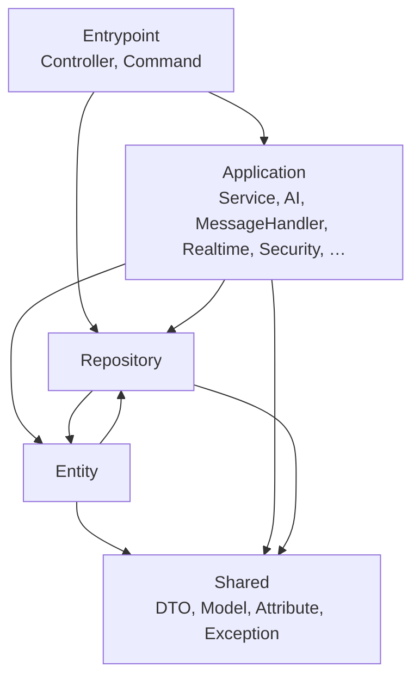
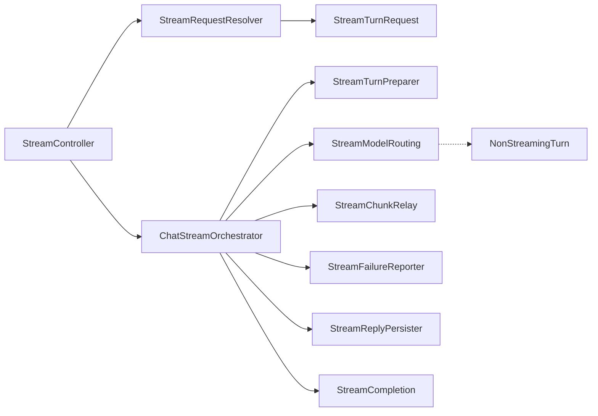

# Backend architecture

How the Symfony backend in `backend/` is put together, and where new code
goes. Two checks keep the shape: deptrac enforces the layers, and the size
ratchet keeps classes and methods small. Both run in `make ci-local` and CI.

The request paths below were "god classes" until the code cleanup V2 sprint
(`_devextras/planning/20261014-code-cleanup-V2/`). The runtime config and the
chat turn sections describe the code of [#2498](https://github.com/metadist/synaplan/pull/2498)
and [#2499](https://github.com/metadist/synaplan/pull/2499).

## Layers

| Layer | Namespaces (`App\…`) | May use |
| ----- | -------------------- | ------- |
| Entrypoint | `Controller`, `Command` | Application, Repository, Entity, Shared |
| Application | `Service`, `AI`, `Mcp`, `Realtime`, `Plug`, `Prompt`, `Module`, `Runtime`, `Message`, `MessageHandler`, `EventSubscriber`, `EventListener`, `Security`, `Seed`, `Observability`, … | Application, Repository, Entity, Shared |
| Repository | `Repository` | Repository, Entity, Shared |
| Entity | `Entity` | Entity, Repository, Shared |
| Shared | `DTO`, `Model`, `Attribute`, `Exception` | Shared |

`backend/deptrac.yaml` is the source of truth. `make -C backend deptrac` fails
on a new violation. The baseline (`deptrac.baseline.yaml`) only lists what
predates the gate and may only shrink: fix the import (move a value object to
`App\Model\`, pass a value instead of a service), never add an entry.

## Size limits

A file has at most 800 lines, a constructor at most 10 parameters, a method
body at most 100 lines. `make -C backend metrics` prints how many files,
constructors and methods exceed that, with the largest of each kind.

`tests/Architecture/SizeRatchetTest.php` freezes every offender that existed
when the limits came in (`sizeRatchetBaseline.json`). A frozen entry may
shrink or disappear, never grow, and a new offender fails the test. When the
test goes red, put the new code into a class of its own instead of the one
that is already too big. After shrinking a class, regenerate the ledger with
`UPDATE_SIZE_RATCHET=1` — its diff contains removals only.

Value objects count too: a constructor with eleven fields is split into
smaller objects that each mean something (see the stream request below).

## Runtime config — `GET /api/v1/config/runtime`

`ConfigController` only delegates. `RuntimeConfigAssembler` merges the
payload from services tagged `app.runtime_config.contributor`: auth, billing,
chat, features, branding, speech and modules each own their part. `features`
is merged one level deep; every other top-level key belongs to exactly one
contributor, and a second writer throws. A new runtime key is a new
contributor, not a new branch in the controller.

The model routes of the same controller delegate to `ModelListingService`,
`ModelDefaultsService`, `RoutingModelsService` and `ModelAvailabilityCheck`.
Large OpenAPI response schemas live in `App\Attribute\OpenApi\Config\*`, so
the routes stay in one controller: the spec orders `paths` by route
registration, and the frontend pins a hash of the spec.

## Chat turn — `ChatHandler`

`App\Service\Message\Handler\ChatHandler` answers a message with the model the
person chose. It is a short orchestrator; every turn runs through the same
stages in `App\Service\Message\Chat\`:

| Stage | Produces |
| ----- | -------- |
| `ChatTurnContextLoader` | `ChatTurn`: runtime profile, topic prompt, knowledge base, memories |
| `ChatModelSelector` | `ChatModelChoice`: "Again" > widget > assistant > prompt > default; retired models swapped; image model fallback |
| `ChatSystemPromptAssembler` | `ChatSystemPrompt`: sections in channel order, or a user-turn fallback for models without a system role |
| `ChatMessageAssembler` | the provider messages |
| `ChatRequestOptions` | document schema, routing tools, token ceiling, sampling, reasoning level |
| `ChatReplyGenerator` | `ChatReply`: document tool loop or chat call, with the cut-off and empty-answer checks |
| `PendingMemoryExtraction` | the memory job, dispatched now or after the reply is stored |

`handle()` serves the buffered channels (email, webhook, MCP, Telegram) and
`handleStream()` the web chat and the widget. Each stage has a
`forBufferedTurn()` and a `forStreamedTurn()` that share their private
sections. The remaining differences between the two (when a deferred routing
decision is checked, the voice rules, how a generated file is delivered) are
named in the stage that owns them. Aligning them is behaviour work and shows
in the prompt snapshots of `tests/Characterization/`.

## Chat stream — `POST|GET /api/v1/messages/stream`

`StreamController` keeps its four routes and their OpenAPI attributes and
delegates:

- **Request.** `StreamRequestResolver` turns the request into a typed
  `StreamTurnRequest`: the caller (signed-in person, widget visitor, guest —
  `StreamCallerResolver`), the pinned assistant (`StreamAgentPinResolver`),
  the input, the options and the incognito history. A request that cannot
  start a turn becomes a `StreamRequestRejected` with its JSON error, or the
  guest-limit event.
- **Turn.** `ChatStreamOrchestrator` runs inside the streamed response:
  report a rate limit, open the resumable run, prepare the chat and the
  incoming message, route a model that cannot stream to `NonStreamingTurn`,
  relay the chunks, then report a failure or store the reply and send
  `complete`. Every path closes the run; nothing is left "running".
- **Wire.** `SseWriter` writes one `data:` frame per event and records it in
  the run, so a client that reloads can re-attach. The event names are an
  external contract: the web chat, the widget, the desktop and the mobile
  apps read them. A new event is a `feat:` with frontend work.
- **Stop.** `CancelledTurns` flags a turn the caller owns and stores the
  partial answer the client sends.

`tests/Characterization/StreamTranscriptCharacterizationTest.php` locks the
ordered event names and payload shapes of six turns; a split that changes a
frame fails it.

## Where new code goes

- A controller method validates and delegates. Business logic lives in a
  service — `final readonly`, constructor injection, one concern.
- An optional feature is a `FeatureModule` (`App\Module\`), not an
  `isEnabled()` branch.
- State that several steps of one request share is a value object (immutable
  where possible) passed from step to step, not a growing list of parameters.
- Database queries live in repositories; entities do not import services.
- See `AGENTS.md` for the merge gate and `docs/PHP_CONVENTIONS.md` for code
  style.
