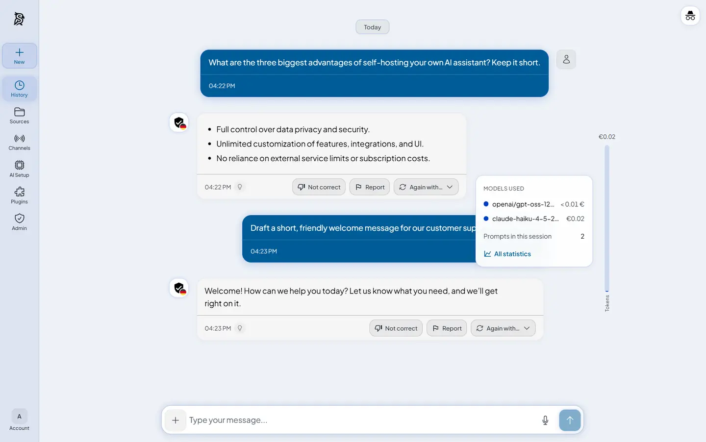

> **[Main README](../README.md)** · **[Documentation Index](README.md)** · **Track 1: Getting Started & Deployment (1/8)**  
> **← Previous:** [Documentation Index](README.md) · **Next:** [1.2 Installation & Deployment →](INSTALLATION.md)

# Platform Capabilities & Mental Model

> **In this guide:** A tour of what Synaplan does and how its pieces fit together—from multi-provider chat and DAG task planning to RAG document search, long-term memory, isolated file work, external channels, and team governance.

---

## How the Workspace Is Organized

Synaplan separates everyday work from configuration and administration along five rail areas (see [UX Contract](UX_CONTRACT.md)):

| Rail Area | Who Sees It | What Lives There |
| --------- | ----------- | ---------------- |
| **Chats** | Everyone | Everyday conversations, live voice, research reports, generated media, and the **Incoming chats** inbox for shared threads. |
| **Library** | Everyone | Uploaded documents, knowledge folders, generated media gallery, persistent **Workspace** files from Python/Node runs, and shared folders. |
| **Assistants** | Everyone | Custom AI assistants (instructions, knowledge folders, tools, triggers), **Saved Tasks** (scheduled or webhook workflows), and the **Approvals** inbox. |
| **Apps** | Everyone | Connected external systems (Microsoft 365, Dropbox, Nextcloud/WebDAV, CalDAV, IMAP, MCP servers), **Chat Widgets**, **WhatsApp**, **Email**, **Synaplan Desktop**, and **Coding Clients** (`/v1` & `/v1/messages`). |
| **Admin** (*Operate*) | Administrators | System overview, **System status** (`/admin/features`), **AI infrastructure** (provider keys, model health, extraction, RAG, reranking), **Users & groups**, and **System configuration**. |

---

## 1. AI Chat, Cost Transparency & Effort Routing



Instead of locking a workspace to one vendor, Synaplan routes each capability slot (`CHAT`, `PIC2TEXT`, `TEXT2PIC`, `TEXT2VID`, `SOUND2TEXT`, `TEXT2SOUND`, `VECTORIZE`, `SORT`, `ANALYZE`) independently:

- **14+ Cloud & Local Providers** — OpenAI, Anthropic, Google Gemini, Groq, Mistral, xAI, Meta, Cerebras, TrustedTokens (German sovereign GPUs), A2Agent, HuggingFace, TheHive, Higgsfield, Cloudflare Workers AI, and local **Ollama** (`gpt-oss`, `llama`, `bge-m3`, etc.).
- **Real Cost on Every Answer** — Every model carries its official provider rate (`priceIn` / `priceOut` per 1M tokens, or per image/second/character). The model picker displays a **Free / Low / Mid / High** badge, and every chat reply records the exact cost in USD.
- **Adaptive Effort Routing** — On each message, the sorter (`tools:sort`) decides whether the question needs a direct **answer**, a quick web **lookup**, or a multi-round **[Deep Research](RESEARCH.md)** run with cross-model fact checking.
- **Web Search Plugs** — Administrators choose between Brave, self-hosted **SearXNG**, Tavily, Exa, Firecrawl, or Perplexity under **Operate → System configuration → Web search**, with an optional fallback and per-user override.
- **Self-Aware `/help` Assistant** — Ask *"What can you do here?"* or type `/help`; the assistant answers from a live capability inventory of this specific installation (`PlatformCapabilityInventory`) and the synced documentation corpus, never from a generic brochure.

---

## 2. Multi-Task DAG Routing & Saved Tasks

When a prompt asks for several steps at once (*"Find the latest email from Acme, summarize the attached PDF, and save a briefing in my Nextcloud"*), Synaplan does not hope a single LLM call will improvise everything:

```
User Message → MessageClassifier / MessageSorter (tools:sort)
  ├─ Single-step → ChatHandler | MediaGenerationHandler | FileAnalysisHandler
  └─ Multi-step  → TaskPlanner (tools:plan) → DagExecutor → ResultAssembler
```

- **AI Task Planner** — Decomposes complex requests into a directed acyclic graph (DAG) of data nodes (`web_search`, `url_fetch`, `mcp_fetch`, `mcp_action`, `email_search`, `rag_query`) and generator nodes (chat, summarize, image/video/audio, Office documents, `code_run`). See [Multi-Task Data Nodes](MULTITASK_DATA_NODES.md).
- **Live Task Cards & Step Graph** — Each node streams its progress over SSE (`plan`, `task_update`, `task_chunk`, `task_file`) and renders as a live card and an inspectable step graph in chat.
- **Saved Tasks & Webhooks** — Any multi-step plan or custom instruction can be pinned as a **Saved Task** and run on demand, on a schedule (hourly, daily, weekdays), or via an HMAC-signed inbound webhook (`POST /api/v1/webhooks/saved-tasks/{token}`). Three consecutive failures auto-pause the task. See [n8n and Saved Tasks](N8N.md).

Configuration: [CONFIGURATION.md → Multi-Task Routing](CONFIGURATION.md#multi-task-routing-bconfig) and [CONFIGURATION.md → Saved Tasks](CONFIGURATION.md#saved-tasks-bconfig).

---

## 3. Knowledge Base (RAG), Session Files & Memory

Synaplan combines three distinct memory layers so the assistant can read your documents, keep track of files in the current thread, and remember facts across months of conversations:

| Layer | Scope | How It Works | Guide |
| ----- | ----- | ------------ | ----- |
| **Knowledge Base (RAG)** | Uploaded files & shared folders | Extracts text via **Apache Tika** (or optional **Docling** for tables/headings), OCRs images (Tesseract/Vision), transcribes audio (Whisper), embeds chunks with `bge-m3` (1024-dim), and searches **MariaDB VECTOR** or **Qdrant** (hybrid BM25 + vector + optional reranker). | [RAG.md](RAG.md) |
| **Session Files** | Current conversation | `ConversationFileCatalog` tracks every uploaded and generated file in the thread (`Files in this chat`) so follow-ups like *"check the whole contract"* or *"make the car blue"* automatically target the right file. | [SESSION_FILES.md](SESSION_FILES.md) |
| **Rolling Summary & Deep Memory** | Long threads & all past chats | Long threads are compressed into a rolling markdown summary (`BCHATSUMMARIES`) in the background. A daily job (`app:digest:run`) indexes key facts and decisions into Qdrant (`BMESSAGEDIGESTS`) with recency-weighted retrieval and `[Message:ID]` citations. | [CONVERSATION_CONTINUITY.md](CONVERSATION_CONTINUITY.md) |

---

## 4. Tools, Approvals, File Work & Office Documents

Every tool execution across the platform passes through a single gate (`ToolInvoker`):

- **Unified Tool Registry & Approvals** — Built-in tools, connected MCP servers, and user-defined HTTP/OpenAPI tools share one policy engine. Read-only calls run immediately; write-class actions pause with an approval card in chat and in the **Approvals** inbox, and record a `tool.executed` row in the audit log.
- **File Work (Secure Compute)** — The assistant can run short Python or Node scripts on *copies* of user-selected files inside an isolated container sidecar (`sidecars/synaplan-compute`), returning generated charts, spreadsheets, or archives to chat and the user's persistent **Workspace**. See [COMPUTE.md](COMPUTE.md).
- **Office Document Engine** — Generates and revises `.docx`, `.xlsx`, and `.pptx` files step by step. When the optional **Collabora CODE** sidecar is running, Synaplan adds thumbnails, inline preview, "Download as PDF", "Combine as PDF", and browser editing.

---

## 5. Channels, Gateways & Companion Apps

The same assistant, knowledge folders, and model policies are reachable from every surface your team uses:

| Surface | What It Does | Guide |
| ------- | ------------ | ----- |
| **Chat Widget & Live Support** | Single-script Shadow DOM widget for any website, with domain whitelisting and live human operator takeover over **Centrifugo + Redis** WebSockets. | [WIDGET.md](WIDGET.md) · [REALTIME.md](REALTIME.md) |
| **WhatsApp Business** | Bidirectional messaging via Meta's Cloud API: up to 20 phone numbers, voice-note transcription, media generation, and optional phone verification. | [WHATSAPP.md](WHATSAPP.md) |
| **Email Channel** | Inbound email webhook and IMAP polling with `smart+keyword@` topic threading, plus live read-only mailbox search across IMAP and Microsoft 365. | [EMAIL.md](EMAIL.md) |
| **External Connections** | OAuth and app-password connectors for **Microsoft 365** (Outlook mail & calendar), **Dropbox**, **Nextcloud / ownCloud / WebDAV**, **CalDAV**, and **Jira & Confluence** (MCP). | [CONNECTIONS.md](CONNECTIONS.md) |
| **OpenAI-Compatible API (`/v1`)** | Drop-in `/v1/chat/completions`, `/v1/models`, and one-shot or multi-session streaming `/v1/audio/transcriptions` for OpenAI SDKs, Cursor, and Continue. | [OPENAI_COMPATIBLE_API.md](OPENAI_COMPATIBLE_API.md) |
| **Anthropic Messages API (`/v1/messages`)** | Native gateway for **Claude Code** and coding clients, with server-side `web_search`, `web_fetch`, vision routing, pinned knowledge tools, and multi-provider aliases. | [ANTHROPIC_COMPATIBLE_API.md](ANTHROPIC_COMPATIBLE_API.md) |
| **Synaplan Desktop** | Tauri desktop app (Windows, macOS, Linux) that pairs via a one-time code, receives a restricted `desktop:*` API key, and executes local Agent Skills over the frozen `protocol: 1` contract. | [DESKTOP.md](DESKTOP.md) |
| **Live Voice & Meeting Notes** | Full-duplex speech-to-speech (`LIVE_VOICE.md`), self-hosted Realtime websockets (`LIVE_VOICE_SELF_HOSTED.md`), and Jitsi/Element transcription (`OPENDESK_MEETING_NOTES.md`). | [LIVE_VOICE.md](LIVE_VOICE.md) · [OPENDESK_MEETING_NOTES.md](OPENDESK_MEETING_NOTES.md) |

---

## 6. Users, Groups, Sharing & Governance

- **Groups & Directory Sync (`IAM`)** — Create manual groups or sync memberships automatically from OIDC `groups` claims on sign-in.
- **Resource Sharing** — Share conversations, knowledge folders, AI assistants, Saved Tasks, and chat widgets with specific people, groups, or the whole instance (**Can view** vs. **Can use**).
- **Group Policies & Locked Defaults** — Assign default models, allowed model allowlists, feature switches, and rate-limit tiers per group, or lock instance-wide defaults so users cannot override them.
- **Privacy by Default** — Administrators manage users, quotas, and audited impersonation (`View as user`), but cannot read another user's private chats, files, or assistants unless shared. See [ADMIN.md](ADMIN.md#users-and-groups).

---

> **[Main README](../README.md)** · **[Documentation Index](README.md)** · **Track 1: Getting Started & Deployment (1/8)**  
> **← Previous:** [Documentation Index](README.md) · **Next:** [1.2 Installation & Deployment →](INSTALLATION.md)
