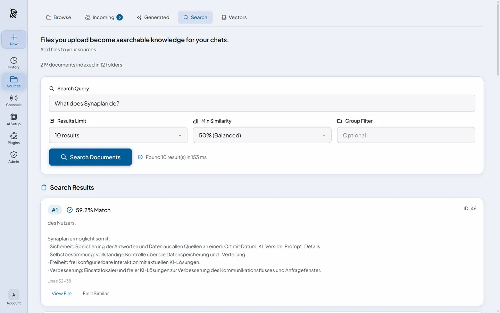
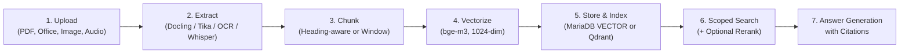

> **[Main README](../README.md)** · **[Documentation Index](README.md)** · **Track 3: AI Engine, Knowledge & Execution (1/6)**  
> **← Previous:** [2.9 AWS Marketplace AMI Operations](AWS_MARKETPLACE_LISTING.md) · **Next:** [3.2 Conversation Continuity & Deep Memory →](CONVERSATION_CONTINUITY.md)

# Knowledge Base & RAG System

> **In this guide:** How Synaplan turns uploaded documents, spreadsheets, images, and audio into searchable knowledge—covering extraction chains (Tika, Docling, Collabora, OCR, Whisper), `bge-m3` embeddings, MariaDB `VECTOR` vs. Qdrant hybrid BM25 search, optional reranking, and owner-scoped sharing.



---

## End-to-End RAG Pipeline



1. **Upload** — Files are uploaded into **Library** (optionally organized into knowledge folders/groups).
2. **Extract** — Synaplan runs the family extraction chain (`PLUGS`, configured under **Admin → AI infrastructure → Document reading**).
3. **Chunk & Vectorize** — Text is split into chunks (heading-aware for Docling markdown so tables stay intact) and embedded into 1024-dimensional vectors (default: `bge-m3`).
4. **Store** — Vectors are stored in **MariaDB 11.8+ native `VECTOR`** (default) or **Qdrant** (which adds a full-text BM25 index).
5. **Retrieve & Rerank** — Queries search across the caller's authorized owner scopes, optionally reorder candidates with a dedicated reranker, and inject the top passages into the prompt.

---

## Supported Formats & Extraction Chains

Extraction is governed by per-family chains (`EXTRACTION.CHAIN.*` in `BCONFIG` group `PLUGS`; see [CONFIGURATION.md — AI plugs](CONFIGURATION.md#ai-plugs-plugs)):

| Family | Supported Formats | Extraction Chain (Order of Execution) |
| ------ | ----------------- | ------------------------------------- |
| **Plain Text** | `.txt`, `.md`, `.csv`, `.html` | Native parser |
| **Documents & Office** | `.pdf`, `.doc`, `.docx`, `.rtf`, `.odt`, `.xls`, `.xlsx`, `.ods`, `.ppt`, `.pptx`, `.odp`, Apple iWork (`.pages`, `.numbers`, `.key`) | Optional **Docling** sidecar (layout/table-aware markdown) → structured Office reader (sheet-by-sheet with `A1` coordinates; slide-by-slide with speaker notes) → **Collabora CODE** conversion → **Apache Tika** → PDF Vision fallback (when extracted text fails the length/entropy quality gate) |
| **Images** | `.png`, `.jpg`, `.jpeg`, `.gif`, `.webp`, `.tiff`, `.bmp` | Vision model description / Tesseract OCR |
| **Audio** | `.mp3`, `.wav`, `.ogg`, `.m4a`, `.opus`, `.flac`, `.webm`, `.aac`, `.wma` | Cloud STT provider or local **Whisper.cpp** (with FFmpeg) |
| **Video** | `.mp4`, `.mov`, `.webm` | Audio transcript + key-frame vision description |

### Document Processing Levels on Upload

When uploading documents via the UI or API (`process_level`), you choose how far the upload pipeline runs:

| Level | Parameter | What Happens (Documents) | When to Use |
| ----- | --------- | ------------------------ | ----------- |
| **Store Only** | `store` | Saves the file on disk without extraction | Output artifacts from Secure Compute or Desktop skills |
| **Extract Only** | `extract` | Extracts text, no vector embeddings | Quick one-off preview in a single chat |
| **Extract + Vectorize** | `vectorize` | Extracts text, chunks it, and stores embeddings | Standard Knowledge Base / RAG search (default; any unknown value such as `analyze` falls back to `vectorize`) |
| **Full Analysis** | `full` | Extracts and vectorizes; the AI-processing step currently returns `ai_processed: false` (*"AI processing not yet implemented"*) | Reserved for full upload-time AI processing |

> **Media uploads (images, audio, video):** Uploading an image, audio, or video file stores the file and returns `media_pending_describe: true` without running extraction or vectorization at upload time (even when `process_level` is `vectorize` or `full`). To transcribe or describe media and index it into RAG, call `POST /api/v1/files/{id}/describe` (the **Describe, vectorize & sort** action in the Library UI).

---

## Vector Storage: MariaDB VECTOR vs. Qdrant Hybrid Search

Synaplan supports two vector backends (`VECTOR_STORAGE_PROVIDER`, managed under **Admin → AI infrastructure → Knowledge search**):

| Capability | MariaDB 11.8+ `VECTOR` (Default) | Qdrant (`http://qdrant:6333`) |
| ---------- | -------------------------------- | ----------------------------- |
| **Semantic Search** | Cosine distance (`VEC_DISTANCE_COSINE`) | Cosine similarity |
| **Keyword / Exact Match** | Meaning-only (no keyword leg) | **Hybrid BM25 + Vector**: creates a full-text index on chunk text on first use. Rare terms (article numbers, product SKUs) are weighted by exact corpus IDF within the searcher's scope; words appearing in >50% of chunks are ignored. Keyword and vector hits are combined via reciprocal rank fusion. |
| **AI Memories & Digests** | Requires Qdrant | Powers user memories, message digests, and feedback analysis |

---

## Reranking

After vector (or hybrid) retrieval, an optional rerank model can re-score a wider candidate pool and keep the best `k` passages. Reranking is **off by default** (`RERANK.ENABLED = 0`).

1. Storage fetches `min(k × RERANK.CANDIDATES_MULTIPLIER, 100)` candidates (default multiplier: `4`).
2. The bound catalog rerank model (TEI `openaicompatible`, Jina, Cohere, or Voyage) scores each candidate (truncated to `RERANK.MAX_CANDIDATE_CHARS`, default `2000`) within `RERANK.LATENCY_BUDGET_MS` (default `800` ms).
3. On success, the top `k` chunks are returned with `rerank_score`.
4. On timeout, HTTP error, or empty output, the pipeline degrades gracefully and keeps the first `k` chunks in embedding order so chat still answers.

`RERANK.LLM_FALLBACK = 1` uses the summary model for listwise ranking only when **no** dedicated rerank model is bound—never as a retry when an HTTP reranker times out. Configure and test under **Admin → AI infrastructure → Knowledge search → Reranking**.

### Evaluating Rerank & Hybrid Recall

Compare rerank off vs. on against a user's live vector store:

```bash
docker compose exec -T backend php bin/console app:rag:eval-rerank \
  --user=<id> --k=5 --report=var/rerank-eval.md
```

The report measures `recall@5`, `MRR`, and `p50`/`p95` latency (off vs. on). Note that the command requires a bound rerank model (or `LLM_FALLBACK=1`) and temporarily flips `PLUGS.RERANK.ENABLED=1` during the "on" pass—run it off-peak on busy instances.

To evaluate Qdrant hybrid search (keyword + vector rank fusion) without touching the rerank switch:

```bash
docker compose exec -T backend php bin/console app:rag:eval-rerank --hybrid --user=<id> --k=5
```

---

## Sharing & Search Scopes

Documents are **private by default**. A RAG search **never** runs without an explicit, non-empty list of owner scopes:

- **Your own files** are always scope 1.
- **Shared folders (`IAM.SHARING_ENABLED`)**: When someone shares a knowledge folder (or a referenced chat file) with you or your group at permission **Can use** or higher, that owner+folder becomes an additional search scope. Hits from shared files carry `shared: true` and the owner's display name.
- **Can view is not searchable**: A share with **Can view** lets a person browse the folder in **Library**, but never injects its chunks into RAG searches.
- **Research runs**: Deep research only searches and reads files when files are enabled as a source for that run, re-verifying the share before opening each file.
- **Public link sharing**: Individual files can also be shared externally via token-based links with optional expiry dates.

---

## Configuration & API Reference

### Environment Defaults (`backend/.env`)

```bash
# Default search parameters
RAG_DEFAULT_THRESHOLD=0.5
RAG_DEFAULT_LIMIT=10

# Optional Qdrant URL (started automatically by docker-compose.yml)
QDRANT_URL=http://qdrant:6333
```

### HTTP API Endpoints

```bash
# 1. Upload and index a document
POST /api/v1/files/upload

# 2. Semantic / hybrid search across authorized scopes
POST /api/v1/rag/search
{
  "query": "quarterly sales report for DACH",
  "threshold": 0.5,
  "limit": 10
}

# 3. Fetch file metadata or content
GET /api/v1/files/{id}
```

---

> **[Main README](../README.md)** · **[Documentation Index](README.md)** · **Track 3: AI Engine, Knowledge & Execution (1/6)**  
> **← Previous:** [2.9 AWS Marketplace AMI Operations](AWS_MARKETPLACE_LISTING.md) · **Next:** [3.2 Conversation Continuity & Deep Memory →](CONVERSATION_CONTINUITY.md)
