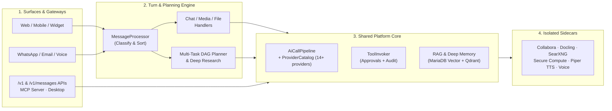

> **[Main README](../README.md)** · **[Platform reference](PLATFORM_REFERENCE.md)** · **Documentation Index** · **[Public User Docs (docs.synaplan.com)](https://docs.synaplan.com/)**  
> **Start the Learning Path:** [1.1 Platform Capabilities & Mental Model →](FEATURES.md)

# Synaplan Documentation

> **How to use these docs:** User-facing product guides live at **[docs.synaplan.com](https://docs.synaplan.com/)**. This `docs/` directory is the **in-repository technical manual** for operators, integrators, and contributors. Every page below belongs to one of five sequential learning tracks and includes a navigation header linking to the previous and next step.

---

## How Synaplan Works in 60 Seconds

Synaplan is not a single-model chat wrapper. It is a multi-channel AI workspace where **every channel shares one routing engine, one knowledge layer, one tool gate, and one cost ledger**.

1. **Conversation intake (`MessageProcessor`) vs. direct API gateways (`/v1`, `/v1/messages`, `/mcp`).** Interactive and messaging channels (web chat, mobile, embedded widget, WhatsApp, inbound email, and Saved Tasks) pass through `MessageProcessor`'s classification cascade (`SlashCommandRoute` → `AgentPinRoute` → `AttachmentIntent` → AI `MessageSorter`). Machine gateways (`/v1/chat/completions`, `/v1/messages`, and `/mcp`) bypass `MessageProcessor` and connect directly to the shared core (`OpenAiGatewayToolLoop` / `MessagesGateway` → `AiCallPipeline` & `ToolInvoker`).
2. **Right-sized execution (`ChatHandler`, `TaskPlanner`, `Research`).** Simple turns go straight to the chosen model. Multi-step prompts are decomposed into a directed acyclic graph (DAG) of data and generation nodes (`web_search`, `mcp_fetch`, `email_search`, `code_run`, media). Complex factual questions trigger a multi-round `Research` run whose claims are verified by a second model before delivery.
3. **One AI & tool boundary (`AiCallPipeline` & `ToolInvoker`).** Every AI provider call traverses `AiCallPipeline` (request correlation, circuit breaker, model health, cost accounting). Every tool call—across chat, `/v1/messages`, `/v1/chat/completions`, Saved Tasks, and MCP—passes through `ToolInvoker`, which enforces read/write approval policies and writes an audit record for every mutating call.
4. **Core vs. optional sidecars.** The core requires only PHP (FrankenPHP), MariaDB, and Redis. Heavy capabilities—local LLMs (`ollama`), vector memory (`qdrant`), realtime WebSockets (`centrifugo`), document extraction (`tika`, `docling`), Office conversion (`collabora`), Python/Node sandboxes (`compute`), and voice (`tts`, `voice`, `transcriber`)—run as optional containers that degrade cleanly when switched off.

---

## Choose Your Learning Path

Pick the track that matches your role, or jump directly to any guide in the tables below.

| Track | Who it is for | Start here |
| ----- | ------------- | ---------- |
| **[Track 1: Getting Started & Deployment](#track-1-getting-started--deployment)** | Anyone installing, configuring, or upgrading Synaplan | [1.1 Platform Capabilities & Mental Model](FEATURES.md) |
| **[Track 2: Administration, Security & Billing](#track-2-administration-security--billing)** | Operators running Synaplan for a team, organization, or paying customers | [2.1 Day-2 Operations & Governance](ADMIN.md) |
| **[Track 3: AI Engine, Knowledge & Execution](#track-3-ai-engine-knowledge--execution)** | Engineers and power users learning how RAG, memory, planning, research, and compute work | [3.1 Knowledge Base & RAG](RAG.md) |
| **[Track 4: Channels, Gateways & Integrations](#track-4-channels-gateways--integrations)** | Integrators connecting M365, Nextcloud, n8n, Claude Code, OpenAI SDKs, Desktop, Widget, or Voice | [4.1 External Connections](CONNECTIONS.md) |
| **[Track 5: Developer & Contributor Guide](#track-5-developer--contributor-guide)** | Contributors and coding agents modifying the PHP backend, Vue SPA, database, or test suite | [5.1 Local Development Workflow](DEVELOPMENT.md) |

---

## Track 1: Getting Started & Deployment

Start here to understand what Synaplan ships with, choose the right deployment topology, configure your first administrator and AI provider keys, and keep a self-hosted instance updated safely.

| Step | Guide | What you will learn |
| ---- | ----- | ------------------- |
| **1.1** | **[Platform Capabilities & Mental Model](FEATURES.md)** | How chat, multi-task routing, RAG, channels, and optional sidecars fit together, and how the UI navigation is organized. |
| **1.2** | **[Installation & Deployment](INSTALLATION.md)** | How to deploy via one-file Quickstart, production `deploy/compose.yaml`, closed-network TLS, or local development (`make up`). |
| **1.3** | **[Configuration & AI Providers](CONFIGURATION.md)** | Where settings live (`backend/.env` vs. Admin UI vs. `BCONFIG`), first-run wizard, OIDC/SSO login, and connecting cloud or local AI providers. |
| **1.4** | **[Feature Flags & Module Gates](FEATURE_FLAGS.md)** | How every platform feature flag resolves (`FEATURE_*` env pin → user → group → global `BCONFIG`) and how to hide unconfigured modules. |
| **1.5** | **[Runtime & Outbound Options](RUNTIME_OPTIONS.md)** | Quick reference for FrankenPHP `api` and `streams` worker pools, the capacity watchdog, usage hook, and outbound HTTP switches. |
| **1.6** | **[Updating a Self-Hosted Instance](UPDATE_SELFHOST.md)** | The four-step backup, version pin, upgrade, and rollback workflow for `deploy/` and Docker GUI Quickstart volumes. |
| **1.7** | **[Updating on Elestio](UPDATE_ELESTIO.md)** | Taking a manual recovery snapshot, updating `SYNAPLAN_VERSION`, and redeploying an Elestio CI/CD pipeline. |
| **1.8** | **[Updating on AWS Marketplace](UPDATE_AWS.md)** | Connecting via AWS Session Manager, snapshotting the EBS data volume, and running `sudo synaplan-update`. |

---

## Track 2: Administration, Security & Billing

Once an instance is running, this track covers day-to-day administration: user and group governance (`IAM`), health monitoring, privacy-safe error logs, outbound network control, Stripe/IAP billing, and maintaining the AI model catalog.

| Step | Guide | What you will learn |
| ---- | ----- | ------------------- |
| **2.1** | **[Day-2 Operations & Governance](ADMIN.md)** | Admin password recovery, the 5-lane background scheduler, portable backups, users & groups (`IAM`), sharing policies, directory sync, and AI plugs. |
| | **[Who can create an account, and who can sign in](IDENTITY.md)** | The four install profiles, which door a new account comes through, which switch closes it, and the variables that look like switches and are not. |
| **2.2** | **[Health Probes & Uptime Monitoring](HEALTH_MONITORING.md)** | The difference between `/api/health`, `/api/health/ready`, and `/api/health/probe`, and how to set up a dedicated Uptime Robot monitor key. |
| **2.3** | **[Observability & Redacted Error Ring](OBSERVABILITY.md)** | How `X-Request-Id` correlates logs and how the Redis event ring exposes PII-scrubbed warnings/errors to `/api/v1/admin/logs` and MCP. |
| **2.4** | **[Outbound Traffic & Egress Control](EGRESS.md)** | Every outbound connection Synaplan makes, how `ProviderCatalog` populates the allowlist, SSRF IP pinning, and the optional egress proxy. |
| **2.5** | **[Self-Hosted Billing (Stripe)](BILLING_SELFHOST.md)** | Why billing is off by default (unrestricted open-source mode) and how to connect your own Stripe account to sell plans. |
| **2.6** | **[Payment Channels & Store IAP](PAYMENTS_CHANNELS.md)** | Cross-channel entitlement rules across Web (Stripe), iOS (StoreKit 2), and Android (Play Billing), store commission markup, and signup guards. |
| **2.7** | **[Model Catalog & Pricing Maintenance](PRICING_MAINTENANCE.md)** | How `CostCalculationService` bills tokens/media/audio, the 7-step price verification playbook, LiteLLM sync, model discovery, and retirements. |
| **2.8** | **[Resolving Model Price Drift](PRICE_DRIFT_PROCEDURE.md)** | Step-by-step runbook when the daily `app:sync-model-prices --fail-on-drift` check reports a discrepancy against LiteLLM. |
| **2.9** | **[AWS Marketplace AMI Operations](AWS_MARKETPLACE_LISTING.md)** | How the free AWS Marketplace AMI is built with Packer, verified in CloudFormation, and published via the Catalog API. |
| **2.10** | **[Where a message goes](DATA_FLOW.md)** | Hosted platform, a selected cloud model, or a self-hosted install. The public trust center cites this page. |

---

## Track 3: AI Engine, Knowledge & Execution

Deep-dive into how Synaplan processes documents, maintains short- and long-term conversation memory, plans multi-step workflows, conducts verified multi-round research, and runs isolated code.

| Step | Guide | What you will learn |
| ---- | ----- | ------------------- |
| **3.1** | **[Knowledge Base & RAG](RAG.md)** | How uploads flow through extraction (Tika, Docling, OCR, Whisper), `bge-m3` vectorization, MariaDB Vector vs. Qdrant hybrid BM25 search, and reranking. |
| **3.2** | **[Conversation Continuity & Deep Memory](CONVERSATION_CONTINUITY.md)** | How rolling summaries compress long chats (`BCHATSUMMARIES`) and how daily message digests (`BMESSAGEDIGESTS` + Qdrant) recall facts from months ago. |
| **3.3** | **[Session Files & Follow-Up Edits](SESSION_FILES.md)** | How `ConversationFileCatalog` tracks uploaded and generated files across a thread so follow-up questions and image edits find the right file. |
| **3.4** | **[Multi-Task Planner & Data Nodes](MULTITASK_DATA_NODES.md)** | How `TaskPlanner` builds a capability DAG, pulls live external data (`web_search`, `url_fetch`, `mcp_fetch`, `email_search`), and guarantees handover. |
| **3.5** | **[Deep & Automatic Research](RESEARCH.md)** | How `tools:sort` rates question effort (`answer` / `lookup` / `research`), runs a 5-phase investigation, verifies every citation with a second model, and writes the report. |
| **3.6** | **[Secure Compute (File Work)](COMPUTE.md)** | How the assistant runs isolated Python and Node scripts on copies of user files, manages per-user workspaces, and enforces quotas and egress rules. |

---

## Track 4: Channels, Gateways & Integrations

Learn how to connect external cloud storage, mailboxes, calendars, automation webhooks, coding clients (Claude Code, Cursor), the Synaplan Desktop app, website widgets, messaging channels, and live voice.

| Step | Guide | What you will learn |
| ---- | ----- | ------------------- |
| **4.1** | **[External Connections](CONNECTIONS.md)** | Setting up Microsoft 365 (Graph mail & calendar), Dropbox, Nextcloud / ownCloud / WebDAV, CalDAV, and Jira & Confluence (MCP). |
| **4.2** | **[Saved Tasks & n8n Webhooks](N8N.md)** | Starting a Saved Task from n8n via HMAC-signed inbound webhooks and posting step results out to external HTTPS endpoints. |
| **4.3** | **[OpenAI-Compatible API (`/v1`)](OPENAI_COMPATIBLE_API.md)** | Using Synaplan with any OpenAI SDK for `/v1/chat/completions`, client & server tool calling, and one-shot or streaming `/v1/audio/transcriptions`. |
| **4.4** | **[Anthropic-Compatible Messages API (`/v1/messages`)](ANTHROPIC_COMPATIBLE_API.md)** | Connecting Claude Code and coding clients, the server-tool vs. client-tool funnel, `web_search`, `web_fetch`, vision routing, and model aliases. |
| **4.5** | **[Synaplan Desktop Protocol](DESKTOP.md)** | How the Tauri desktop app pairs, mints scoped `desktop:*` API keys, uses the machine companion routes, and polls the frozen `protocol: 1` job queue. |
| **4.6** | **[Embeddable Website Chat Widget](WIDGET.md)** | Embedding the Shadow DOM widget with one `<script>` tag, configuring domains and styling, and taking over live visitor chats over WebSockets. |
| **4.7** | **[WhatsApp Business Channel](WHATSAPP.md)** | Connecting Meta's WhatsApp Business API webhook for multi-number AI replies, voice note transcription, and phone verification. |
| **4.8** | **[Email Channel & Smart Addressing](EMAIL.md)** | Routing inbound emails (`smart+keyword@`), configuring IMAP mailbox handlers, and percent-encoding `MAILER_DSN` for SMTP. |
| **4.9** | **[Live Voice (Full-Duplex Speech)](LIVE_VOICE.md)** | Running the speech-to-speech voice sidecar over WebSocket relay or OpenAI WebRTC, with factual chat delegation and media artifact cards. |
| **4.10** | **[Self-Hosted Live Voice Endpoints](LIVE_VOICE_SELF_HOSTED.md)** | Pointing the live voice sidecar at your own OpenAI-Realtime-compatible server (vLLM-Omni / Qwen3-Omni, Azure Realtime, Qwen Cloud). |
| **4.11** | **[openDesk Meeting Notes (Jitsi & Matrix)](OPENDESK_MEETING_NOTES.md)** | Live Jitsi meeting captions and Element voice-message transcription using the `synaplan-transcriber` sidecar. |

---

## Track 5: Developer & Contributor Guide

Everything you need to develop, test, and ship changes to Synaplan while keeping every architecture, UX, and CI gate green.

| Step | Guide | What you will learn |
| ---- | ----- | ------------------- |
| **5.1** | **[Local Development Workflow](DEVELOPMENT.md)** | Starting the dev stack (`make up`), understanding the Messenger `worker`, toggling feature modules, running Make targets, and using test accounts. |
| **5.2** | **[Backend Architecture & Request Lifecycle](ARCHITECTURE.md)** | Deptrac layer rules, size ratchets, FrankenPHP pools, `MessageProcessor`, `ChatHandler`, `AiCallPipeline`, `ProviderCatalog`, `ToolInvoker`, and account erasure. |
| **5.3** | **[Adding an AI Provider](PROVIDERS.md)** | How `ProviderDescriptor` drives every provider table and how to scaffold a new OpenAI-compatible provider in one command (`app:provider:scaffold`). |
| **5.4** | **[Backend PHP Conventions](PHP_CONVENTIONS.md)** | PSR-12, `declare(strict_types=1)`, thin controllers, `final readonly` services, DBAL 4 / Repository rules, and `#[AdminPreview]`. |
| **5.5** | **[Frontend Vue & TypeScript Conventions](FRONTEND_CONVENTIONS.md)** | CSS design tokens, button/input house classes, Heroicons action map, 5-locale namespace i18n, and chat stream handlers. |
| **5.6** | **[OpenAPI & Zod Schema Pipeline](API_PATTERNS.md)** | Writing complete `@OA\*` attributes on PHP controllers and generating runtime-validated TypeScript Zod schemas for `httpClient`. |
| **5.7** | **[Realtime WebSocket Architecture](REALTIME.md)** | How Centrifugo + Redis fan-out works and the 7-step playbook for adding a typed channel, parser case, authorizer, publisher, and Vue composable. |
| **5.8** | **[Database Migrations & Seeders](MIGRATIONS.md)** | Doctrine migrations, the self-healing startup bootstrap, two-phase expand/contract column drops, and `ModelSeeder` content fingerprints. |
| **5.9** | **[UX Contract (Rules U1–U12)](UX_CONTRACT.md)** | The 12 binding UX rules, shared UI patterns (Share dialog, sibling inboxes, galleries, triggers), and browser journey gates. |
| **5.10** | **[End-to-End Testing (Playwright)](E2E_TESTING.md)** | Running `@ci` Playwright suites, selector registry rules, deterministic terminal-state racing, worker auth fixtures, and troubleshooting local failures. |
| **5.11** | **[Reviewing Renovate Dependency PRs](DEPENDENCY_UPDATES.md)** | How to verify peer dependencies, Docker image digests, lockfile hotspots, and coordinated major upgrades without breaking `main`. |

---

## Quick Task Lookup ("I want to...")

| Goal | Guide |
| ---- | ----- |
| Spin up Synaplan in 3 minutes | [Installation & Deployment](INSTALLATION.md) |
| Add or rotate an AI provider key | [Configuration — AI Providers](CONFIGURATION.md#ai-providers) |
| Recover a lost admin password | [Admin — Lost Administrator Password](ADMIN.md#lost-administrator-password) |
| Decide who can create an account or sign in | [Who can create an account, and who can sign in](IDENTITY.md) |
| Set up OIDC / Enterprise SSO | [Configuration — SSO-Only Instances](CONFIGURATION.md#sso-only-instances-no-local-accounts) |
| Connect Microsoft 365, Dropbox, or Nextcloud | [External Connections](CONNECTIONS.md) |
| Point Claude Code or Cursor at Synaplan | [Anthropic-Compatible API](ANTHROPIC_COMPATIBLE_API.md) · [OpenAI-Compatible API](OPENAI_COMPATIBLE_API.md) |
| Add a new AI provider in PHP | [Adding an AI Provider](PROVIDERS.md) |
| Trace how a chat message or tool call executes | [Backend Architecture](ARCHITECTURE.md) |
| Add a database column or catalog model | [Database Migrations & Seeders](MIGRATIONS.md) |
| Check UI styling, icon, or i18n rules | [Frontend Conventions](FRONTEND_CONVENTIONS.md) · [UX Contract](UX_CONTRACT.md) |
| Run the pre-commit quality gate | [Local Development Workflow](DEVELOPMENT.md) · [AGENTS.md](../AGENTS.md) |

---

> **[Main README](../README.md)** · **Documentation Index** · **Next:** [1.1 Platform Capabilities & Mental Model →](FEATURES.md)
