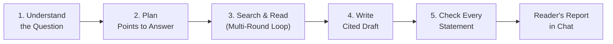

> **[Main README](../README.md)** · **[Documentation Index](README.md)** · **Track 3: AI Engine, Knowledge & Execution (5/6)**  
> **← Previous:** [3.4 Multi-Task Planner & Data Nodes](MULTITASK_DATA_NODES.md) · **Next:** [3.6 Secure Compute (File Work) →](COMPUTE.md)

# Deep & Automatic Research

> **In this guide:** How Synaplan conducts multi-round, source-backed research—covering automatic effort routing (`answer` / `lookup` / `research`), the 5-phase investigation loop, two-stage citation verification (deterministic quote check + cross-lab model verification), the live SSE event stream, and the `/api/v1/research` and `/v1/research` APIs.

Research is **on by default** unless an administrator turns it off. A user can start a run (or let chat start one automatically), follow its progress across five phases, stop it early with **Answer now** or **Stop**, ask follow-ups, and delete it. When a run belongs to a chat, the server writes the verified report directly into that chat—even if the browser tab was closed while it ran.



---

## Switch

| Layer | Configuration | Behavior |
| ----- | ------------- | -------- |
| **Environment** | `RESEARCH_ENABLED=1` / `RESEARCH_ENABLED=0` | `1` pins research on; `0` pins it off. Empty follows the database row. |
| **Database** | `BCONFIG` group `RESEARCH`, setting `ENABLED`, owner `0` | Seeded `1` on new installs (`Version20261028110000` enabled existing installs once). |
| **Module Gate** | `FEATURE_MODULES_GATE_RESEARCH=true` | Makes the start routes return `404` while research is off. |
| **Concurrency** | `RESEARCH.MAX_ACTIVE_RUNS` (default `5`), `RESEARCH.MAX_ACTIVE_THOROUGH_PER_USER` (default `1`) | Per-user limits on simultaneous active runs and thorough runs. |

While research is off:
- `capabilities`, `start`, `input` (reply), and `followups` return `404`.
- Reading an existing run, streaming its events, cancelling it, and deleting it **keep working** so in-flight or historical runs can still be opened and cleaned up.
- Any research unit that starts after research was switched off writes what it has already found and stops with: `"Research was turned off on your Synaplan workspace."`

---

## Automatic research

There is no separate "research mode" button or menu entry. Instead, the chat decides how much effort a question needs during the existing `tools:sort` classification call:

- **`BEFFORT`**: `answer` (direct reply), `lookup` (quick web search), or `research` (multi-round investigation).
- **`BEFFORT_WHY`**: names the single reason (`several_parts`, `comparison`, `procedure`, `current_fact`, `asked_thorough`, `asked_short`, `simple`, `deeper`).
- If a sorting model does not populate those fields, it counts as no vote and the chat answers directly.
- Automatic escalation only happens on an **ordinary signed-in web chat turn**—never on a widget, a Saved Task, an incognito chat, an "Again" retry, a pinned task prompt, or a channel without a chat.

### How an Automatic Run Behaves in Chat

1. **Stream start:** When `BEFFORT` is `research`, the turn starts a run with depth `auto`. The SSE stream emits `research_started` with the run ID first, and the assistant reply carries `researchRunId` (meta `research_run_id`), both live and after a page reload. Non-UI channels receive the fallback notice sentence (*"I am looking through several sources for this — about N minutes. The question has several parts."*).
2. **Five live phases in the reply bubble:**
   - *Understanding the question* → *Planning the answer* → *Searching and reading* → *Writing the answer* → *Checking every statement*.
   - The headline shows the current step count and elapsed time (hidden when the admin timing switch is off).
   - Completed phases fold to a one-line summary (*"2 points · 1 answered"*, *"4 searches · 6 sources read · 1 could not be opened"*) and expand on click.
   - The active phase stays open and shows up to six recent rows (queries, sources read, end-of-round decisions, sections written) with a *"Show N earlier steps"* toggle; upcoming phases stay muted.
3. **Interactive controls:**
   - **Answer now** (`answer_now` input) sits below the phases and asks the run to write the report immediately from the sources already read (or fall back to a direct chat answer if no source was read yet).
   - **Stop** replaces the send button in the composer while the run is active and keeps whatever was already written.
4. **Completion:** When the run finishes, the verified report replaces the reply's text in place, with a muted summary line below (*"Researched: 12 steps · 8 sources read"*) that reopens the folded phases in any later session.

### When a Run Cannot Start & "Look Deeper"

If a question is rated `research` but cannot start a run, the chat answers directly and prefixes the reply with a plain-language explanation of the limit:
- `no_sources` — Web search is off and no knowledge folder is pinned on the chat.
- `too_many` — The user already has `RESEARCH.MAX_ACTIVE_RUNS` active runs.
- `budget` — The user's cost budget is exhausted.
- `plan_limit` — The subscription plan's research allowance is spent.
- `unavailable` — The Redis research store is unreachable.

The reply records `effort` and `effortNotice`, which surfaces the **Look deeper** action beneath any `lookup` answer and beneath any answer that hit a limit. Clicking **Look deeper** starts a run of depth `auto` with hint `deeper` and the last six chat turns as context.

### How `auto` Depth Sizes Itself

After the planning step:
- A plan with **1–2 points** is capped at the `quick` budget.
- A larger plan gets the `standard` budget.
- The `plan` event and run state both record the resolved `ceiling` (`quick` or `standard`) and estimated minutes.
- Hint `brief` (when the sorter voted `asked_short`) caps the plan at two points; hint `deeper` lets it expand. Automatic runs never pause to ask clarifying questions.

### Automatic Research Configuration, Eval & Gateway

| Area | Details |
| ---- | ------- |
| **Admin Switch** | `BCONFIG` group `RESEARCH`, setting `AUTO_ENABLED`, owner `0` (seeded `1`). Located on **Admin → AI infrastructure → Research** under the main Research toggle. When off (or when `RESEARCH_ENABLED=0`), chat answers every question directly and **Look deeper** is hidden; runs already in flight finish. Audited as `research.settings.update`. `PUT /api/v1/admin/research` accepts `autoEnabled` (returns `409 research_off` if Research itself is off). |
| **Capabilities API** | Exposes `automatic` (boolean) and `auto_limits { minutes, cost_cap }` from the standard budget. |
| **Router Evaluation** | `php bin/console app:research:router-eval --user=<id>` scores `backend/tests/Eval/research/router.json` against that account's sorting model. Gate thresholds: agreement ≥ 90%, over-escalation ≤ 5%, under-escalation ≤ 10%, no vote ≤ 2%. |
| **Messages Gateway** | `POST /v1/messages` with header `x-synaplan-effort: auto` runs the same `AutoResearchGate::decideFor` check. When a run starts, the gateway returns the notice sentence as one assistant message plus `x-synaplan-research-run: <id>`, and the caller polls `GET /v1/research/{id}`. Without the header, the gateway never rates. See [ANTHROPIC_COMPATIBLE_API.md — Effort](ANTHROPIC_COMPATIBLE_API.md#effort-x-synaplan-effort). |

---

## Multi-Round Investigation & Citation Verification

### Search & Read Rounds

After each round of searching and reading sources, the run evaluates open plan points and decides whether to search again (up to the depth's round ceiling; `quick` runs only one round). The loop moves to report writing when:
- No new queries or unread sources remain, or
- The remaining model-call budget is only enough to write and check the report.

A plan point marked "answered" without an attached evidence card stays open. Depth time limits measure active step execution only—time spent waiting for a worker or user input is not counted.

### Two-Stage Fact & Citation Check

Every report is verified before delivery:

1. **Stage 1 — Free deterministic check:**
   - Every cited statement must reference an evidence ID that actually exists (`p1` plan-point references are not valid sources).
   - Numbers, dates, and proper names in the statement must appear in the cited evidence.
   - Uncited factual statements and statements backed only by web sources outside the brief's time frame are removed.
2. **Stage 2 — Cross-model verification (`DEFAULTMODEL.VERIFY`):**
   - A second model reads each remaining cited statement alongside its evidence passages and grades it `supported`, `partial`, `unsupported`, or `contradicted` (in batches of up to 30 statements).
   - **Standard & Quick runs** keep only `supported` statements and delete rejected ones (they are never moved into the writer's *"Not confirmed"* section, and any cited claim hidden inside *"Not confirmed"* is checked too).
   - **Thorough runs** attempt one revision pass for `partial` statements: keeping only the supported portion and reporting how many claims were shortened. If the revision introduces a new fact or keeps an unsupported citation, the removal stands.
   - **Same-family safeguard:** If the checker and writer resolve to the same model lab (`meta.family`), the model checker is skipped; a statement survives only when backed by a verified quote within the time frame, and the report notes that the workspace has a single model family.

### Lead Tool Mode & Conformance Suite

When `RESEARCH.LEAD_MODE` is `auto`, a model listed in `RESEARCH.TOOL_MODE_MODELS` (JSON list of catalog keys `service:providerId:tag`) drives each round via native `search`, `read`, `ask`, and `finish` tools. Calling `finish` before reading any source is refused once while unread sources remain.

A model is added to `RESEARCH.TOOL_MODE_MODELS` only after passing all 10 scenarios (20 turns total, against test-double search/pages) in the conformance suite:

```bash
docker compose exec backend php bin/console app:research:conformance groq:openai/gpt-oss-120b:chat --user=1
```

---

## Routes

The same endpoints are exposed at **`/api/v1/research`** (session-authenticated web app) and **`/v1/research`** (API key with `desktop:messages` scope):

| Method | Path | Behavior (and Status When Research Is Off) |
| ------ | ---- | ------------------------------------------ |
| `GET` | `research/capabilities` | Returns enabled state, depth budgets, and `automatic` / `auto_limits`. (`404` when off) |
| `POST` | `research` | Starts a run. Optional `Idempotency-Key` (`1–64` chars of `[A-Za-z0-9._:-]`) deduplicates for 24h. Session route requires `chat_id`; API route forbids `chat_id`. (`404` when off) |
| `GET` | `research` | Lists the caller's runs from the last 48 hours, newest first (`?active=1` filters to active runs). |
| `GET` | `research/{id}` | Returns the run state if owned by the caller (`404` otherwise). Includes `queued_since` if waiting >20s for a worker. |
| `GET` | `research/{id}/events` | SSE stream of run events (`Last-Event-ID` or `?after=` resumes). |
| `POST` | `research/{id}/input` | Sends an interactive action to an active run: answers open clarifying questions, confirms a thorough plan, sends `stop_gathering` (*Write now* — ends search/collection and starts writing the report from current findings), or sends `answer_now` (*Answer now* — writes the report immediately if sources were read, or ends the run with `answered_without_research` so chat answers directly). (`404` when off) |
| `POST` | `research/{id}/cancel` | Requests the run to stop. Idle runs close immediately; active steps stop before their next paid model call. |
| `POST` | `research/{id}/followups` | Starts a linked follow-up run once the parent run has finished (`409` while parent is still running). (`404` when off) |
| `DELETE` | `research/{id}` | Deletes the run, its events, and cached pages (any message already posted to chat stays). |

### Follow-Up Types (`POST research/{id}/followups`)

A follow-up creates a new run that inherits the parent's sources, numbering, and world scope (keeping the parent's report as prior context so an early stop never echoes the old report as new):

| Type | `text` Required? | What It Does |
| ---- | ---------------- | ------------ |
| `question` | Yes | Runs a `quick` pass: answers directly from existing findings if ≥50% of query words match, otherwise searches once. Sets `can_add_to_report` on completion. |
| `revise` | Yes | Rewrites the parent report per instruction (shorter, board summary, translation, table). Unchanged cited sentences keep their verification verdict; modified sentences are re-checked. (`409` if parent has no report) |
| `deeper` | Optional | Runs with the `thorough` budget, turning each item under *"Not confirmed"* (up to 8) plus `text` into plan points. |
| `refresh` | Optional | Re-reads sources dated before the brief's time frame (or all read sources if undated) and reports what changed. |

---

## Where the report goes

When a run has a `chat_id`, the server writes one assistant message into that chat:

- **Reader's report vs. checked report:** The chat message displays the clean **reader's report** (closing verification counts and emptied headings are stripped, and internal evidence IDs `[e12][e31]` are renumbered to `[1][2]` matching the source list beneath the message). If verification removed every sentence, the message displays the gaps under *"Not confirmed"*.
- **Verification & cost transparency:** The research fold under the reply receives the `check` summary (`statements`, `supported`, `softened`, `removed`, `same_provider`), and the message info panel breaks down token usage and cost across every role (`LEAD`, `READ`, `WRITE`, `VERIFY`, `SORT`).
- **Stopped or failed runs:** If a run stops or fails after finding evidence, the reason sentence is placed above the partial report so it is never mistaken for a complete run; if nothing was found, only the reason sentence is posted.

### Live Event Stream (`research/{id}/events`)

| Event | Payload Fields | Source & Meaning |
| ----- | -------------- | ---------------- |
| `thinking` | `text` | Streamed lead note in tool mode (flushed every 160 chars or 0.7s). |
| `thought` | `text` | Finished lead note before tool calls (≤600 chars; replaces `thinking`). |
| `plan` | `points[].why` | Reason each plan point was included. |
| `source` (`found`) | `why` | Why triage selected the page (≤200 chars). |
| `source` (`read`) | `findings` | Number of evidence cards extracted (`0` = nothing new for the plan). |
| `finding` | `source`, `point`, `fact`, `confidence`, `quote` | Extracted evidence card (up to 4 per source) with its verified quote. |
| `point` | `note` | Lead or reflection status note on a plan point. |
| `round` | `reason` | Why the round ended (`covered`, `budget`, `no_progress`, or lead sentence). |
| `draft` | `text` | Streamed report draft chunks until replaced by the verified report. |
| `verdict` | `statement`, `verdict`, `note`, `part`, `reason` | Up to 8 claims that verification softened (`partial`), dropped (`contradicted`, `unsupported`), or failed in draft check (`uncited`, `number`, `name`, `unknown_id`). |

---

## Saved tasks

A Saved Task can include a `research` step when both `MULTITASK.RESEARCH_ENABLED` and `RESEARCH.ENABLED` are on:
- The step starts a `quick` or `standard` run in the task's chat and pauses the task worker while research units execute on their own queue.
- When the report finishes, `ContinueSavedTaskAfterResearch` resumes the Saved Task on the worker and hands the formatted report (with numbered sources at the end) to the next step (for example, an email or webhook step) under the unattended approval policy.
- If the research fails, is stopped, or cannot hand over within 30 minutes, the step fails cleanly and downstream steps are skipped.

---

## Operator

The **Admin → System status** page displays the count of active research runs when Research is enabled. Stalled runs, expired clarifying questions (~10 min), and unconfirmed thorough plans (24h) are reaped automatically by `app:research:reap` on the scheduler tick.

---

> **[Main README](../README.md)** · **[Documentation Index](README.md)** · **Track 3: AI Engine, Knowledge & Execution (5/6)**  
> **← Previous:** [3.4 Multi-Task Planner & Data Nodes](MULTITASK_DATA_NODES.md) · **Next:** [3.6 Secure Compute (File Work) →](COMPUTE.md)
