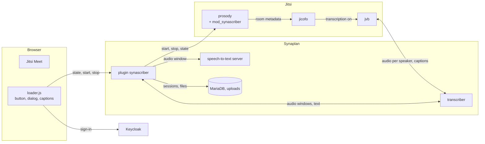

# How meeting notes work

Condensed from the planning documents of the former synaScriber repository
and checked against the code of plugin 0.4.x. The setup is in
[README.md](README.md).

## Overview

Jitsi's bridge streams each speaker's audio to the transcriber. The
transcriber cuts it into short windows and posts them to this plugin. The
plugin gets the text from a speech-to-text server and hands it back as a live
caption. When the notes stop, the plugin writes one Markdown transcript per
signed-in participant into their Synaplan files. Audio is never stored.

| Part | Runs in | Does |
|------|---------|------|
| `frontend/jitsi/loader.js` | each participant's browser, loaded by Jitsi's `head.html` | the floating button, the start dialog, the banner, the caption overlay; signs the person in with Keycloak (public client `synascriber`, PKCE, `prompt=none`) and asks the plugin every 15 s whether notes are on |
| `backend/` | the Synaplan pods | sessions, policy, speech-to-text, the transcript; routes under `/api/v1/plugins/synascriber` |
| `mod_synascriber.lua` | Jitsi's Prosody | turns the bridge transcription of one room on and off when the plugin says so, and reports the roster; clients cannot start it, moderators can still stop it |
| transcriber | its own pod | takes each speaker's Opus from the bridge, cuts windows, posts them to the plugin, sends captions back through the bridge |
| speech-to-text server | its own pod or elsewhere | any server with the OpenAI transcription API; whisper.cpp with a German Whisper large-v3-turbo by default (the `stt` chart) |

## One meeting, in order

1. **Join.** Jitsi's page loads `loader.js` from the plugin's public asset
   route. If the plugin is enabled, the button appears.
2. **Start.** A signed-in person picks a language and a folder. The plugin
   stores a session with a random 22-character reference (`ref`) and calls
   Prosody with the Prosody secret. Prosody checks that the person is in the
   room, sets the room metadata (transcription on, `ref`, language, who
   started) and returns the roster.
3. **Connect.** Jicofo tells the bridge to open a WebSocket to the
   transcriber for that room, with the transcriber token. The transcriber
   binds the socket to the session with the transcriber secret and the
   meeting id. No bot joins, and nobody's browser has to stay open.
4. **Speak.** The bridge sends one Opus stream per participant, never a mix,
   so every line has its speaker. The transcriber posts a preview while
   someone is still talking (captions only, never stored) and a final window
   at a pause, at a soft or hard length limit, or at stop. A window is at
   most 30 s and 2 MB; the plugin takes two at a time per meeting.
5. **Recognise.** The plugin posts the window to the speech-to-text server
   (`verbose_json`, `temperature=0`, the meeting language) and filters the
   answer (below). The kept text becomes a segment (speaker, times) and the
   caption the transcriber sends into the meeting. A failed window is counted
   as a gap, not silently lost.
6. **Stop.** The starter, an administrator, a Jitsi moderator, or the room
   emptying switches transcription off. The transcriber flushes its last
   windows and sends `finished`. The plugin renders one Markdown file and
   writes it for the starter and, with `share_with_participants`, for every
   attendee who has a Synaplan account, into Sources › Generated in the chosen
   folder, extracted and vectorised so chat can answer from it. Guests get no
   copy.

Session states: `starting`, `running`, `stopping`, then one of `saved`,
`nothing_to_save` (nobody spoke) or `failed`. A watchdog runs on every read:
a session that is not connected within 45 s, or not finished within 60 s of
stop, is finalised; a running session asks Prosody every 20 s whether the
room still has the notes on. Sessions belong to the installation (plugin data
under user id 0), not to a person.

## Interfaces

`…` is `/api/v1/plugins/synascriber`.

| From, to | Call | Authentication |
|----------|------|----------------|
| browser, Synaplan | `GET …/assets/jitsi/loader.js` | none (public asset) |
| loader, Keycloak | authorization code with PKCE, `prompt=none`, return to `…/jitsi/silent` | Keycloak |
| loader, plugin | `GET …/jitsi/state?room=`, `POST …/jitsi/sessions`, `POST …/jitsi/sessions/{ref}/stop` | Keycloak bearer token |
| plugin, Prosody | `GET /synascriber/health`, `/state`, `POST /synascriber/start`, `/stop` on :5280 | `Authorization: Bearer` with the Prosody secret |
| bridge, transcriber | WebSocket `:8095/transcribe?…&notes=<ref>` | the transcriber token (`TRANSCRIBER_AUTH_TOKEN`) |
| transcriber, plugin | `GET …/public/transcriber/sessions/{ref}`, `POST …/audio`, `/preview`, `/events` | header `X-Transcriber-Secret` |
| plugin, speech-to-text | `POST /v1/audio/transcriptions`, `GET /health` | none, or `Authorization: Bearer` with `stt_api_key` |
| plugin page, plugin | `GET …/me/sessions`, `GET …/admin/status`, `PUT …/admin/settings` | Synaplan session |

The browser only ever talks to Synaplan and Keycloak. Prosody's API and the
transcriber are reachable inside the cluster only. End-to-end encrypted
meetings cannot be transcribed, because the bridge cannot read them.

## What is stored where

| What | Where | How long |
|------|-------|----------|
| audio | transcriber memory, a PHP temp file per request | seconds |
| captions and previews | messages through the bridge | not stored |
| session, attendees (Keycloak `sub`, e-mail), text per window | `plugin_data`, user id 0 | the session stays, the window text goes when the transcript is written |
| transcript, one copy per recipient | a file in Sources › Generated (`BFILES`, vectors in `BRAG`) | until the person deletes it |
| settings | `BCONFIG`, owner 0, group `P_synascriber`, secrets in plain text | until changed |
| the transcriber's secrets | its environment (Kubernetes Secret) | until uninstall |
| browser | the access token in memory, `localStorage` `synascriber.captions` | tab, permanent |

## Speech-to-text

**What the bridge gives.** One 48 kHz Opus stream per participant with the
browser's echo cancellation, noise suppression and gain already applied, and
nothing during silence (DTX). Quality is limited by the model and by where
the windows are cut, not by the transport.

**Filters in the plugin** (`WhisperClient`), on the segments of
`verbose_json`:

| Drop a segment when | Result |
|---------------------|--------|
| `no_speech_prob > 0.6` and `avg_logprob < -1.0` | `no_speech` |
| the text is a phrase Whisper invents on silence ("Untertitel im Auftrag des ZDF", "Thank you for watching", …, list in the code) | `hallucination` |
| eight or more words with at most two distinct ones | `hallucination` |

A server without these scores (vLLM, some cloud services) skips the first
rule; silence then yields more invented lines than with whisper.cpp.

**Engines, measured on FLEURS de (dev) in October 2026.** Whisper
large-v3-turbo: 5.88 % word error rate; the German fine-tune
`primeline/whisper-large-v3-turbo-german`, the default of the `stt` image:
5.36 %, same size and speed. On one RTX PRO 6000, whisper.cpp transcribes
about 72 times real time (0.17 s per 12.5 s utterance, 2.5 GB VRAM); it
serialises inference, so one process carries roughly fifty meetings with one
active speaker each before queueing. On CPU the same model runs at about
twice real time, enough for development and small installs. The q8_0
quantisation is as accurate as f16 at half the size.

**Language.** One meeting language per session, sent with every window: a
fixed language beats detection on short windows. The caption carries the same
language code, so Jitsi shows it to viewers whose subtitle language matches.

**Captions.** One final caption per window, labelled with the speaker, the
moment the text returns; previews update the same caption while someone is
still talking. Captions and transcript are the same text.
